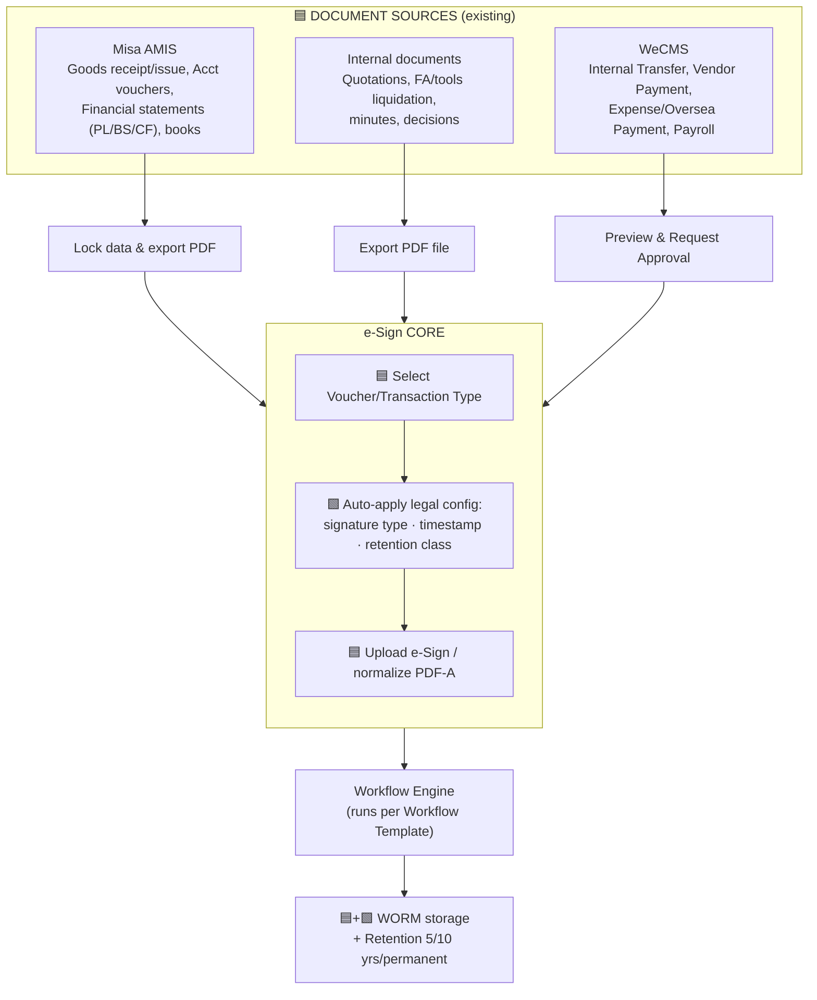
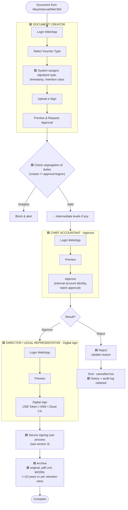
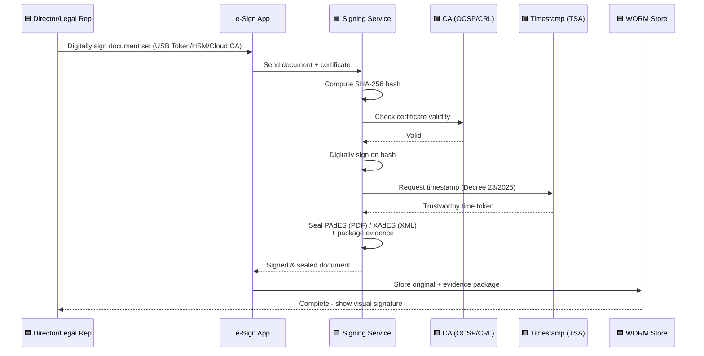
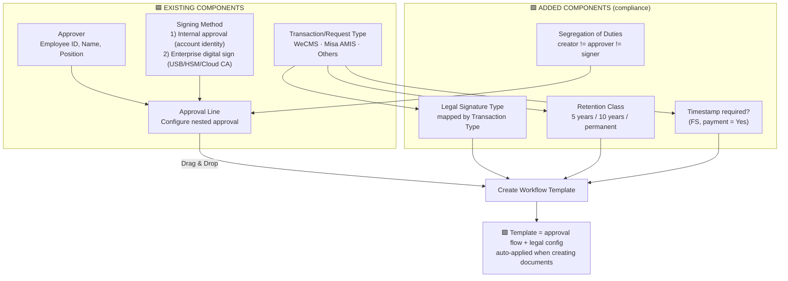
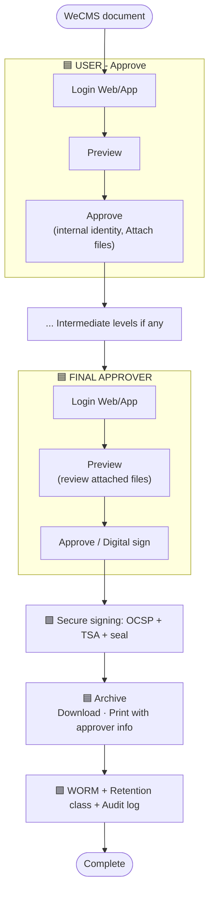

# INTEGRATED e-Sign WORKFLOW — WEBCASH VIETNAM

A document unifying **Webcash's existing model** (Misa AMIS · Internal documents · WeCMS + Workflow Template builder) with the **legal compliance layer** researched (Law on E-Transactions 2023, Decree 23/2025, Accounting Law 2015, Decree 174/2016).

Version 1.0 · 02/07/2026

> **Annotation convention used in this document:**
> 🟦 = component **already existing** in the Webcash model · 🟩 = layer **added for legal compliance**.

---

## 1. Overall integrated architecture (3 sources → e-Sign Core)

**Key integration point:** right after the *Select Voucher/Transaction Type* step (existing), the system **auto-attaches the legal configuration** (🟩) — deciding the signature type, whether a timestamp is required, and the retention period — based on the document type. This configuration comes from the **Workflow Template** (section 4).

---

## 2. Integrated End-to-End workflow (following Webcash's role lanes)

**Mapping Webcash concepts ↔ legal:**

| Webcash step (existing) | Legal nature (added) |
|-------------------------|----------------------|
| Chief accountant "clicks approve, internal account identity" | Secure specialized electronic signature (authenticates signer + approval) |
| Director "digital sign USB Token/HSM/Cloud CA" | Digital signature — legal value equivalent to handwritten signature + seal |
| "Archive original file >= 10 years" | Article 41 Accounting Law + Decree 174/2016 → classify 5/10 years/permanent |
| "Reject still retains history" | Immutable audit log (non-repudiation) |

---

## 3. Sub-process — Secure digital signing (adds compliance to the "Digital sign" step)

> The four 🟩 steps (hash → OCSP/CRL → timestamp → PAdES/XAdES) are exactly the "inserted" part so that Webcash's *Digital sign* step meets the safety conditions of the 2023 E-Transactions Law.

---

## 4. Integrated Workflow Template Builder (upgrade of Webcash's "Workflow" diagram)

**Idea:** keep Webcash's drag-and-drop mechanism (Approval Line + Transaction Type → Create Template), but each **Transaction Type** now carries three legal attributes (signature type, retention class, timestamp requirement) and a **segregation-of-duties** constraint. The template thus defines both *who approves* and *how it is signed & how long it is retained to be lawful*.

---

## 5. Integrated mapping — Transaction Type → Legal configuration

| Source | Transaction/Voucher Type | Signing Method (Webcash) | 🟩 Legal signature type | 🟩 Timestamp | 🟩 Retention |
|--------|--------------------------|---------------------------|--------------------------|--------------|--------------|
| Misa AMIS | Financial statements (PL/BS/CF) | USB Token digital sign | Digital sign · USB Token (company seal) | Mandatory | >= 10 years |
| Misa AMIS | Accounting vouchers, books | USB Token digital sign | Digital sign · USB Token | Yes | >= 10 years |
| Misa AMIS | Goods receipt/issue note | USB Token digital sign | Digital sign · USB Token | Yes | >= 5 years |
| Internal / Others | Quotation | Internal approval | Internal approval (account identity) | System log | Internal policy |
| Internal / Others | FA/tools liquidation | Internal approval | Internal approval (account identity) | System log | >= 10 years |
| WeCMS | Internal Transfer | Internal approval | Internal approval (account identity) | System log | Per resulting acct voucher |
| WeCMS | Vendor / Expense Payment | Internal approval | Internal approval (account identity) | System log | >= 5 years |
| WeCMS | Oversea Payment | Internal approval | Internal approval (account identity) | System log | >= 10 years |
| WeCMS | Payroll | Internal approval | Internal approval (account identity) | System log | >= 5 years |

> **In practice:** only **Misa AMIS** digitally signs with a USB Token (company seal) at the final step — the digital signature appears at the signing position; **WeCMS and Internal/Others** use direct approval via internal account identity only. *Recommendation:* if digital-signature legal value is needed for payment/externally-facing documents, add a digital-signing step at the final approval level.

---

## 6. Integrated WeCMS flow (keep 2 approval lanes + insert compliance)

---

## 7. Integration summary

What is **kept** from Webcash: 3 document sources, the role lanes (Creator / Chief Accountant / Director / User / Final Approver), 2 signing methods (internal approval vs enterprise digital sign), the Reject-with-history mechanism, and the drag-and-drop Workflow Template.

What is **added for legal compliance** (🟩):

- Auto-assign **legal configuration** by Transaction Type at document creation.
- **Segregation of duties** (creator ≠ approver ≠ signer) — mandatory for cash-disbursement documents.
- Insert **hash → OCSP/CRL → TSA timestamp → PAdES/XAdES sealing** into the digital-signing step.
- Classify **retention 5/10 years/permanent** instead of a single blanket ">=10 years".
- **Immutable audit log** for all actions, including Reject.

> This document is for design purposes and does not replace legal advice. Review with legal/audit experts and choose a licensed CA before implementation.
