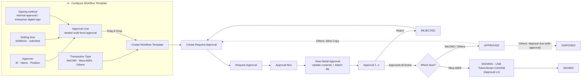

# e-Sign — Process & Functions Analysis (concise synthesis)

Source: the **Workflow** diagram (Webcash). The model has **2 phases**: (A) configure the *Workflow Template* → (B) execute *Request Approval* across 3 lanes (WeCMS · Misa AMIS · Others).

---

## 1. Overall synthesis diagram

---

## 2. Phase A — Configuration blocks (Template building parts)

| Component | Content | Note |
|-----------|---------|------|
| **Approver** | Employee ID, Name, Position… | Approver source |
| **Setting time** | Limited 60/90 min… or *Unlimited* | Per-step SLA → reminders/escalation basis |
| **Approval Line** | Configure nested multi-level approval | Binds Approver + Setting time + Signing method |
| **Signing method** | ① Direct approval (internal account identity) · ② Enterprise digital sign (USB Token/HSM/Cloud CA) | ① = specialized e-sig · ② = digital signature |
| **Transaction Type** | 1) WeCMS (Internal Transfer, Vendor/Expense/Oversea Payment, Payroll) · 2) Misa AMIS · 3) Others | Determines the execution lane |

→ Drag-and-drop **Approval Line + Transaction Type** to **Create Workflow Template**.

---

## 3. Phase B — Request Approval flow (common to all 3 lanes)

`Create Request Approval → Request Approval → Approval Box → View Detail Approval (Update contents + Attach file) → Approval 1..n`

- Each level: **Approve** → next level; **Reject** → state **REJECTED** → back to *Create Request Approval* (redo).
- Approved through all levels → **APPROVED** (or **SIGNED** for Misa AMIS).
- **IN PROGRESS** = still within the approval chain, not yet complete.

---

## 4. Differences across the 3 lanes (key point)

| Criterion | **WeCMS** | **Misa AMIS** | **Others** |
|-----------|-----------|---------------|-----------|
| Nature | Payment/transaction request | Accounting document | Other documents |
| Ending | APPROVED | **Final digital sign** (Approval Ln, USB/Smart CA/HSM) → **SIGNED** | APPROVED |
| Specifics | Multi-level internal approval | Approve 1..n‑1 then **mandatory digital signing** | **Allow Copy** (duplicate request) |
| Distinct state | — | IN PROGRESS · SIGNED | **DISPOSED** (disposal due, with approval) |
| Reject | REJECTED → redo | REJECTED → redo | REJECTED → redo |

**Bottom line:** only **Misa AMIS** goes through a mandatory digital-signing step (digital-signature legal value); WeCMS/Others stop at internal approval. Others adds a disposal lifecycle (DISPOSED) and reuse (Copy).

**Misa AMIS signing flow (detail):** document created in Misa → export/download **PDF** → upload into the internal e-Sign software → approve/sign → **final step requires signature + seal via USB Token** → previewing again shows the **digital signature info right at the signing position** on the document.

---

## 5. States

`IN PROGRESS` → `APPROVED` | `SIGNED` (Misa AMIS) → *(Others)* `DISPOSED` · error branch: `REJECTED` (→ redo).

---

## 6. Function catalog

**A. Configuration (Template)**
- F‑A1 Manage Approver (ID/Name/Position)
- F‑A2 Setting time — per-step SLA (limited/unlimited)
- F‑A3 Configure Approval Line (nested multi-level)
- F‑A4 Select Signing method (internal approval / enterprise digital sign)
- F‑A5 Select Transaction Type (WeCMS/Misa AMIS/Others)
- F‑A6 Create Workflow Template (drag-drop Approval Line + Transaction Type)

**B. Execution (Request)**
- F‑B1 Create Request Approval — *Others allows Copy*
- F‑B2 Request Approval (submit)
- F‑B3 Approval Box (approval inbox)
- F‑B4 View Detail Approval — **Update contents approval** + **Attach file**
- F‑B5 Approval 1..n (multi-level approval per Approval Line)
- F‑B6 **Signing** (Misa AMIS) — digital sign USB Token/Smart CA/HSM at the final level → SIGNED
- F‑B7 Reject (with reason) → REJECTED → redo
- F‑B8 Dispose (Others) — DISPOSED when due, with approval
- F‑B9 State & history management (IN PROGRESS/APPROVED/SIGNED/REJECTED/DISPOSED)
- F‑B10 SLA & reminders/escalation per Setting time

---

## 7. Compliance add-ons (suggested)

Insert into **F‑B6 Signing**: certificate check (OCSP/CRL) → timestamp (TSA) → PAdES/XAdES sealing; and attach a **retention class** on storage to meet the 5/10-year/permanent periods (details in the design document).
